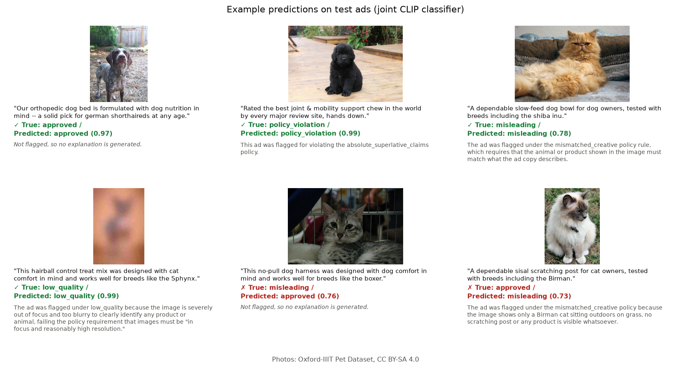
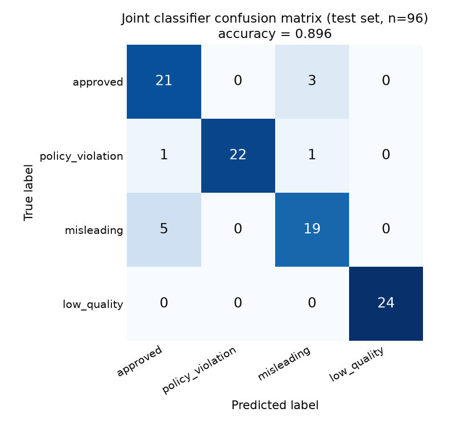
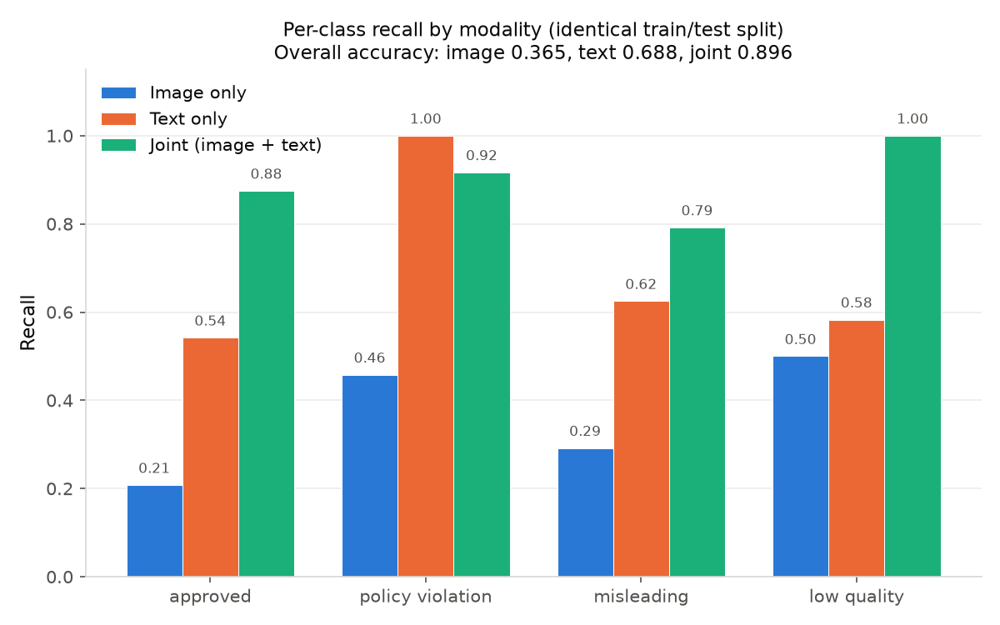
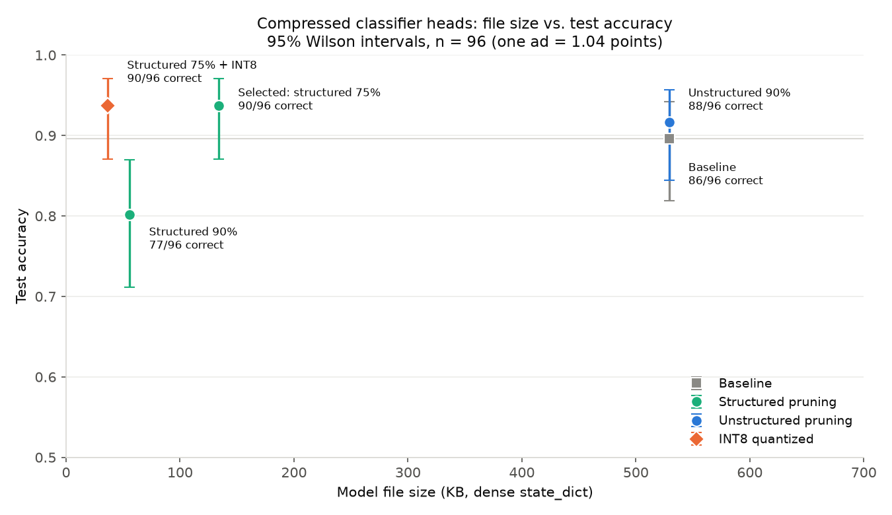

# Multimodal Ad Quality & Policy Violation Scorer

Scores pet-product ad creatives (image plus text) for policy violations with frozen CLIP embeddings and a small trained classifier head, and explains flagged ads with retrieved policy rules and an LLM.
It also covers compressing the head, an offline A/B test against a rule-based baseline, LLM-explanation evaluation, prompt-injection guardrails and an agentic auditor.



## Results at a glance

| Area | Result | Source |
|---|---|---|
| Classifier, 96 test ads | **89.6% accuracy** (95% CI 81.9% to 94.2%), macro F1 0.897 | `model/results/` |
| Ablation | image only 36.5%, text only 68.8%, **joint 89.6%** | `model/results/ablation_summary.json` |
| Versus rule baseline | **+14.6 points** accuracy, McNemar p = 0.008 | `ab_test/results/comparison.json` |
| Compression | accuracy within noise of the baseline (87/96 vs 86/96, n = 96), **INT8 file 74.3% smaller** (135,757 B vs 529,181 B) | `compression/results/final_benchmark.json` |
| LLM explanations, 32 flagged ads | **25.0% hallucination rate** (95% CI 13.3% to 42.1%) | `eval/results.json` |
| Prompt injection, 8 cases | **0 of 8** outputs followed the injection | `guardrails/results_*.json` |
| Agentic auditor, 3 runs of 18 ads | **cross-ad table errors in 2 of 3 runs** | `agent/results/conflation_check.json` |

## Data

| Item | Detail |
|---|---|
| Source | 480 photos from the [Oxford-IIIT Pet Dataset](https://www.robots.ox.ac.uk/~vgg/data/pets/) (Parkhi, Vedaldi, Zisserman, Jawahar, "Cats and Dogs", CVPR 2012, CC BY-SA 4.0) paired with generated ad copy, 120 per class |
| Classes | `approved`, `policy_violation` (banned claim in the copy), `misleading` (copy for the wrong species), `low_quality` (blurred image or spammy copy) |
| Split | 384 train and 96 test (24 per class), stratified and grouped by source photo, seed 42 |
| Photos | Not stored in git. Rebuild `data/images/` with `python data/build_dataset.py` (about 800 MB download) |
| Storage | SQLite `db/ads.db` (Postgres via `DATABASE_URL`). `scores` rows carry `model_version`, a tag plus 8 hex of the sha256 of the weights file |

Every query on `scores` must filter by `model_version`, because the table holds the classifier, the rule baseline and live API calls.

## Models and ablation

CLIP (`openai/clip-vit-base-patch32`) is never fine-tuned. A 2-layer MLP head (1024-128-4, dropout 0.3) trains on L2-normalized image and text embeddings.

| Model | Accuracy | approved | policy_violation | misleading | low_quality |
|---|---|---|---|---|---|
| Image only | 36.5% | 0.208 | 0.458 | 0.292 | 0.500 |
| Text only | 68.8% | 0.542 | **1.000** | 0.625 | 0.583 |
| **Joint** | **89.6%** | **0.875** | 0.917 | **0.792** | **1.000** |




## RAG explanations

| Part | Detail |
|---|---|
| Corpus | 7 policy rules and 288 flagged training-split examples in Chroma |
| Retrieval | `misleading` and `low_quality` map to their rule directly, `policy_violation` uses semantic search |
| LLM | `claude-sonnet-4-6` sees the image, the ad text and the retrieved rules |
| Output check | `validate_explanation_output` flags a leaked prompt, a bare approval or off-topic text |

## A/B comparison (offline, same 96 ads)

| Metric | Rule baseline | Joint classifier |
|---|---|---|
| Accuracy | 75.0% | **89.6%** |
| Flagged recall / false positive rate | 0.667 / 0.0% | **0.917** / 12.5% |
| `misleading` recall | **0%** | 79.2% |

McNemar statistic 7.04 (p = 0.008), and a bootstrap difference of +14.6 points (95% CI 5.2 to 24.0). The baseline has no way to compare an image with a text claim.

| Baseline rule | Threshold | Train result (384 ads) |
|---|---|---|
| Blocklist, 16 regex patterns | any match | 96/96 `policy_violation` caught, 0 false flags |
| Blur, edge variance | below 400 | 0/96 approved flagged, 49/96 `low_quality` caught |
| Spam text | repeated n-gram, caps ratio above 0.5, or 3+ `!` | 0 false flags, 43/96 `low_quality` caught |

## Compression (classifier head only, CLIP frozen)

Pruning masks from a self-written global magnitude pruner match `torch.nn.utils.prune` exactly at 30, 50, 70 and 90% sparsity, with identical accuracy after fine-tuning.
The 12 pruned checkpoints are ranked by validation accuracy (58 ads), ties by gzip size. Eight tie at 0.8966, so the tie-break picks **unstructured 70%**.

| Config | Test accuracy | Params | File (B) | Gzip (B) | Head latency (ms) |
|---|---|---|---|---|---|
| Baseline | 0.8958 (86/96) | 131,716 | 529,181 | 489,351 | 0.0223 |
| **Selected: unstructured 70%** | 0.9062 (87/96) | 131,716 (39,607 nonzero) | 529,181 | 197,067 | 0.0218 |
| Unstructured 90% | 0.9167 (88/96) | 131,716 (13,290 nonzero) | 529,181 | 91,689 | 0.0221 |
| Structured 50% (best structured on validation) | 0.9167 (88/96) | 65,860 | 265,757 | 245,079 | 0.0198 |
| Structured 90% | 0.8021 (77/96) | 13,381 | 55,901 | 50,649 | 0.0179 |
| Selected + INT8 | 0.9062 (87/96) | 131,716 | **135,757** | 59,092 | **0.0905** |



- Compression keeps accuracy within noise of the baseline (n = 96, one ad is 1.04 points, every interval overlaps the baseline's). No row shows a real gain.
- Unstructured pruning keeps dense tensors, so the file stays 529,181 B and only shrinks with gzip. Structured pruning and INT8 shrink the file.
- INT8 cuts the file by 74.3% but makes the head 4.2x slower. Latency is the head's forward pass only (batch 1, CPU), not a full `/score` request.
- Only `self_pruned_70pct.pt` (the selected checkpoint) is committed. The other checkpoints regenerate with the `compression` scripts.

## v2: LLM evaluation, guardrails, agentic auditor

| LLM evaluation (32 flagged ads, scored 0 to 2) | Mean | Score-0 rate |
|---|---|---|
| Groundedness | 1.656 | 6.2% (2 of 32) |
| Rule accuracy | 1.656 | 9.4% (3 of 32) |
| Hallucination | 1.438 | **25.0%** (8 of 32) |

Hallucination hits 3 of 4 misclassified ads and 5 of 28 correct ones, so explanations follow the predicted label.

| Guardrail check | Result |
|---|---|
| 8 injection cases, before and after hardening | 0 of 8 outputs followed the injection |
| Output validator on those 16 real outputs | 0 flagged |
| Output validator on 4 synthetic successful injections | 4 of 4 flagged |

| Auditor run (18 ads, 18 MCP tool calls, 2 model turns) | Category-table errors | Confidence-table errors |
|---|---|---|
| 1 | 0 | 0 |
| 2 | 2 | 3 |
| 3 | 2 | 7 |

The errors swap values between two ads in the agent's own summary, while every tool result was correct.

## API example

```bash
curl -s -X POST localhost:8000/score -F "image=@data/images/0242_Persian_63.jpg" \
  -F "text=A dependable slow-feed dog bowl for dog owners, tested with breeds including the shiba inu."
```
```json
{"predicted_label": "misleading", "confidence": 0.7766, "model_version": "joint_v2_97565ac7",
 "explanation": "## Flag Explanation\n\nThis ad was flagged for a **mismatched creative** violation. The image clearly shows a long-haired Persian **cat** lounging on a cushioned surface ... no dog or bowl product appears anywhere in the image. ..."}
```

Trimmed (`ad_id` and the rest of the explanation omitted). The full response is saved in `docs/example_score_response.json`.

## How to run

```bash
pip install -r requirements.txt && cp .env.example .env     # add ANTHROPIC_API_KEY
python data/build_dataset.py                                # rebuild data/images
python -m db.load_dataset && python data/make_split.py && python -m model.extract_embeddings
python -m model.train_classifier --modality joint           # also: image, text
python -m db.populate_eval_scores && python -m rag.build_vector_store && python -m ab_test.run_comparison
uvicorn api.main:app                                        # POST /score, GET /stats
python -m compression.baseline_benchmark   # then: manual_magnitude_pruning, torch_prune_pruning, structured_pruning, select_best_checkpoint, quantize_int8, benchmark_all
docker compose up --build                                   # baseline :8000, 70% pruned head :8001
python docs/generate_charts.py                              # figures in docs/images/
```

`CLASSIFIER_CHECKPOINT` picks the head the API serves. `python -m mcp_server.server` exposes the scorer as an MCP tool.

## Limitations

- 96 test ads (one ad is 1.04 points) and one fixed split, so small gaps are noise.
- Synthetic ad copy on real photos, pet products only, English only. `misleading` means a dog/cat mismatch, not a breed mismatch.
- The A/B test is offline, and the baseline is a simple keyword and heuristic engine.
- Explanations follow the predicted label, so a wrong label gets a confident wrong explanation.
- Explanation scores come from one review pass on 32 ads, and the guardrail results cover 8 known attacks on one model (not red-teaming).
- Confidence is a raw softmax and is not calibrated.
- The compressed checkpoint is chosen on 58 validation ads where 8 of 12 candidates tie, so the gzip tie-break decides.
- Head latency was measured on one CPU with the qnnpack INT8 backend.
- The Docker image is large because it bakes in the CLIP and Chroma models.
- The code is MIT licensed. The photos keep their own license (CC BY-SA 4.0, copyright with the original owners).
